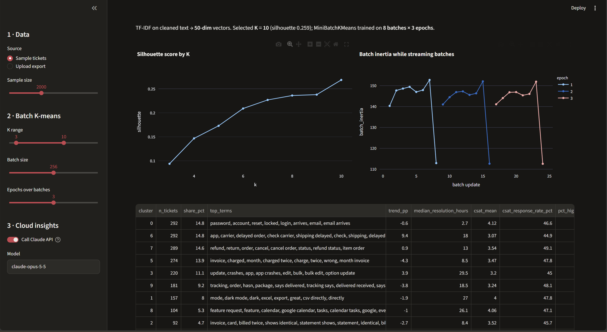
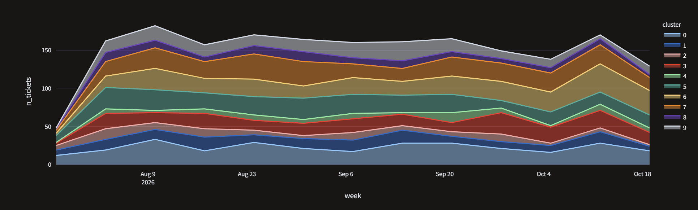
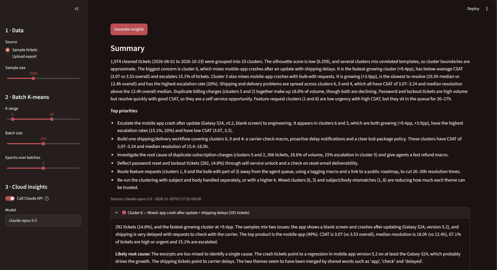

# Customer Support Ticket Analysis

> **Note:** This is just a demo of how a customer support ticket analysis pipeline could work. All ticket data here is made up by a script (`scripts/generate_sample_data.py`). It does not come from, or reflect, any real company, customer or business data.

## Pipeline

It takes a pile of plain-text customer support messages, such as *"I want a refund..."* or *"the app keeps crashing..."*, and outputs a plain-text summary of what people are complaining about and what your team should fix first.

The pipeline is split into 5 steps:

1. **Input** messy tickets (in this demo, randomly generated)
2. **Clean** the tickets
3. **Group** similar tickets using K-means clustering
4. **Connect** to an LLM (in this demo, Claude Opus 5.5)
5. **Output** a readable report

More detail in this demo:

- **Clean**: removes junk (HTML, email signatures, old replies), hides personal info (emails, phone numbers, card numbers), and drops duplicate and empty tickets.
- **Group**: a machine learning model (K-means) groups tickets that talk about the same thing, without any labeling first.
- **Explain**: each group's numbers and a few example tickets go to the Claude API, it writes what the issue is, the likely cause, what to do, and how urgent it is.

## How to Run It

```bash
pip install -r requirements.txt

# Make fake tickets
python scripts/generate_sample_data.py --out data/raw/tickets.csv

# Connect to the Claude API
# Windows PowerShell:
$env:ANTHROPIC_API_KEY = "sk-ant-..."
# macOS / Linux:
export ANTHROPIC_API_KEY="sk-ant-..."

# Run the pipeline
python scripts/run_pipeline.py --input data/raw/tickets.csv
```

View the result in `outputs/reports/insights_report.md`.

**Note** if use a different LLM, make sure to swap out the API call in `support_analysis/insights.py`.

## See It in a Browser with Visualizations

```bash
python -m streamlit run app/streamlit_app.py
```








## Folder Structure

| Folder | What's Inside |
|---|---|
| `support_analysis/` | Cleaning, grouping, the Claude step, the report |
| `scripts/` | Commands to make data, run the pipeline, rebuild the report, and test |
| `app/` | The Streamlit interactive app |
| `tests/` | Tests for the text cleaning |
| `image/` | Screenshots used in this README |
| `outputs/` | Created when you run it: report, results, saved model |

## Testing

```bash
python scripts/smoke_test.py   
```
